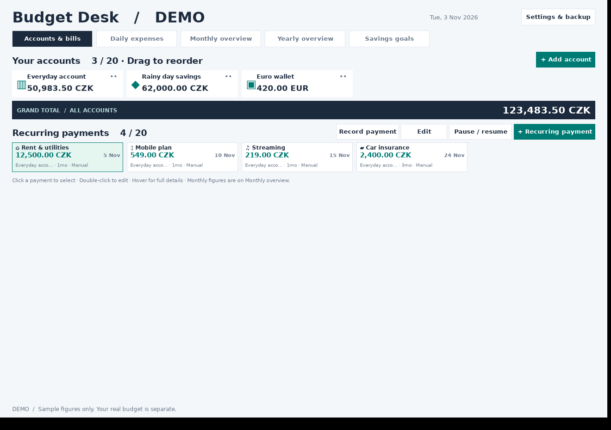

# Budget Desk 1.0.1 review candidate

> [!WARNING]
> **Windows downloads are paused for antivirus review.** Both v1.0.0 and the v1.0.1 review candidate have unresolved antivirus detections. A false positive has not been confirmed. See [current review status](ANTIVIRUS-STATUS.md).

An offline Windows personal budget manager, created by Dimitris L. Track bank accounts, cash, spending, recurring payments and savings without a subscription or bank login.

## Windows download status

Public Windows downloads are temporarily paused while the antivirus reports are reviewed. Version 1.0.1 remains a [review candidate](https://github.com/DimitrisLai/Home-Budget/pull/1). The source and feature documentation remain available below.

[ANTIVIRUS-STATUS.md](ANTIVIRUS-STATUS.md) records the exact executable hashes, reported vendor labels and review progress. Publishing is paused by the repository's `RELEASE-HOLD` file.

## Features

- Compact, reorderable bank-account cards and a combined balance.
- Expenses, income, transfers, custom categories and split purchases.
- Recurring payments with automatic or manual recording.
- One-off future expenses that remain undeducted until recorded as paid.
- Monthly and yearly reports, category budgets and CSV exports.
- Savings goals with tracked allocations, progress and optional deadlines.
- Expense/income templates, optional amounts, saved splits and payee autofill.
- All-history search with account/category/type/date/amount filters.
- Automatic saving, twenty previous versions, JSON backup and restore.
- Page buttons for longer lists and compact layouts at a supported minimum of 1000 × 700.

## About this candidate

Version 1.0.1 removes the developer screenshot command from the distributed executable. UI screenshots run only in separate test programs, and the actual app is opened and closed by a separate startup test. Budgeting features, financial logic, data paths and schema 4 are unchanged.

The same three antivirus labels were reported for the exact tested 1.0.1 executable. Removing the screenshot helper did not resolve them. [ANTIVIRUS-STATUS.md](ANTIVIRUS-STATUS.md) is the current review record. The candidate passed 100 native Windows checks, which are functional evidence rather than antivirus clearance.

## Daily entry shortcuts

**Templates:** Daily expenses → Templates. Create an expense/income shortcut with account, category, payee, description and an optional amount. Use template opens a fresh draft dated today; only Save records a transaction. Split templates keep a fixed total. Save as template in an entry editor saves a shortcut without closing the entry. A separately saved template remains if you cancel the parent entry.

**Payees:** type a shop or person in Payee / shop. Known names suggest their latest saved account/category on a blank new entry. Explicit selections, template presets and existing entries are preserved. The Payees manager edits defaults; renaming or deleting a profile leaves historical payee text unchanged.

**Search all history:** search recorded entries across every year by payee, description, account or category words. Optional date ranges include both endpoints. Full amount filters use each transaction's complete amount in its account currency. Category filters display and total their matched split share. Page buttons expose every result; totals and result exports cover all matching pages.

## Split purchases and future expenses

Enter the full expense amount, choose Split purchase, assign amounts to at least two categories, then Use split and Save. Parts must sum exactly to the total. The account is deducted once. Monthly budgets use assigned shares and yearly totals count the parent purchase once. One category converts a split back to an ordinary expense. Cancelling the parent entry discards its unsaved split changes.

Daily expenses → + Future expense creates a one-off plan with its due date, account, category and amount. It appears under Future / planned across all dates. It stays undeducted even when overdue. After payment, Record paid creates one actual expense on the chosen payment date and removes the plan. This records a payment; it does not initiate a bank transfer.

## Savings goals

Use Savings goals → + New goal to enter a target, currency, saved allocation and optional date. Add savings updates tracking only; it does not move money or alter bank balances. Edit Saved so far to adjust an allocation. Monthly suggestions divide the amount left across calendar months including this month and the target month, rounding up. Current manual rates convert summary values; a goal's currency is locked while a saved allocation exists.

## First setup

1. On **Accounts & bills**, choose **Add account**. Enter a name, icon, currency, opening balance and starting date.
2. Use the balance at the **start of the chosen date**, before the entries you will record for that date. For example: start with 10,000 CZK, then add today's 300 CZK purchase; the account will show 9,700 CZK. If you enter the bank's balance after that purchase, do not enter that purchase again.
3. Add your other bank accounts, savings or cash. Each account has its own balance. The grand total is shown in a slim strip below the account cards.
4. Choose **Recurring payment** to add rent, insurance or a subscription. Select its account, expense category, amount, next unpaid date and repeat interval.
5. Use **Daily expenses → + Category** to add a custom category; **Categories** opens the manager. Optional category budgets appear in Monthly overview.
6. Use **Daily expenses → + Future expense** for a one-off planned payment. It remains undeducted until you record it as paid.

There is a separate limit of **20 accounts**, **20 recurring payment schedules** and **20 expense categories**. There is no 20-entry limit: keep adding daily expenses. Longer lists use Previous/Next buttons; Page Up and Page Down also navigate a focused table. Filtering returns to the first page. Totals and CSV exports include all matching/monthly data, rather than only the visible page.

## Five tabs

| Tab | What it does |
| --- | --- |
| Accounts & bills | Compact account cards, a slim grand total and compact recurring-payment cards, with all 20 of each visible |
| Daily expenses | Recorded entries, one-off future plans, templates, payees and all-history search with paged results |
| Monthly overview | Income, expenses, net cash flow, unpaid plan/bill estimates, category spending and budgets |
| Yearly overview | Year totals, all 12 months, separate unpaid-plan and bill columns, year CSV and monthly details |
| Savings goals | Target amounts, saved allocations, progress, optional dates and suggested monthly savings |

Click an account card to edit it. Click a recurring-payment card to select it, then use Record payment, Edit or Pause / resume. Double-click a payment card or daily-entry row to edit it. Hover over a card for full names, accounts, dates and repeat intervals. Account currency is locked once that account has entries, schedules, one-off plans or templates, protecting their meaning.

## Recurring payments

- Repeat every **1–120 days, weeks, months or years**. Every 3 months is a quarterly payment; every 12 months or 1 year is annual.
- **Automatic recording** is on by default. Due payments become actual expenses, deducted from the selected account. The app checks when it opens and once per minute while open. It does not run in the background when closed; missed due dates are caught up when you next open it.
- **Manual** schedules stay planned until you select them and choose **Record payment**. Upcoming payments do not reduce balances before they are recorded.
- Use the **next unpaid date**, not the date you first ever subscribed. Choosing an old date with automatic recording catches up every occurrence since that date.
- Monthly schedules keep their original day. A schedule starting January 31 falls on February 28 (or 29), then March 31. Merely editing its amount does not shift that anchor.
- Pause a schedule to stop automatic recording. Resuming it catches up overdue dates. To intentionally skip those dates, edit the next unpaid date before resuming.
- Recording early books the expense today and advances the schedule. Late automatic payments are booked on their original due dates, so they appear in the correct months.
- Deleting a recorded expense reverses its balance effect. Its schedule stays advanced and the same occurrence is not automatically added again. Deleting a schedule keeps its historical expenses.
- Editing a schedule changes future recordings. Existing expenses keep their saved amount, account and category.

## Income, transfers and calculations

Expenses reduce their selected account. Income increases it. Transfers deduct from one account and credit another, and are excluded from income and spending totals. For a transfer between currencies, enter the amount actually received by the destination account. Record any bank transfer fee as a separate expense.

Monthly net = income minus expenses. This is cash flow for that month, not the sum of all account balances. Opening balances are not income. Account balances can go negative and will be highlighted.

Supported account currencies: **CZK, EUR, USD, GBP, CHF and PLN**. CZK is the default reporting currency. Enter your own rates when adding a foreign-currency account, or in Settings. There is no online exchange-rate feed.

Rates are entered as **1 unit of the foreign currency = X CZK**. Current account totals use current manual rates. Every income/expense saves its rate when recorded, so subsequent rate changes do not rewrite that entry's original CZK value. Reports in another reporting currency divide those saved CZK values by that currency's current manual rate. Reassigning an entry to another account uses that account's current rate. Automatic catch-up uses the rates available when the app records it, not a historical market lookup.

Category budgets are optional and stored in CZK, then shown in the chosen reporting currency. Changes apply to the displayed budget for all months; this first version does not store separate historical monthly budget plans.

## Saving and backups

Every successful change is saved automatically. The app validates and saves a working copy before replacing the previous file. The previous **20 saved versions** are retained in its **Backups** folder. A failed save leaves the in-memory budget unchanged.

**Settings & backup** offers:

- **Export backup** — a complete JSON copy of accounts, categories, schedules, rates and transaction history.
- **Restore backup** — validate and replace the current budget; the previous version remains in automatic backups.
- **Open data folder** — find the budget and automatic backups.
- **Open a demo window** — try separate sample data.
- **Reporting currency and manual rates**.

Real data: `%LOCALAPPDATA%\BudgetDesk\Data\budget.json`  
Demo data: `%LOCALAPPDATA%\BudgetDesk\Demo\budget.json`

Your data is outside the downloaded program folder, so replacing the app with a later version does not delete your budget. Keep an exported backup before updating. Backups are ordinary, unencrypted JSON files; store them somewhere you trust. Moving the app to a new computer requires exporting/restoring your budget.

If a data file cannot be read, the app leaves it untouched and offers backup recovery. It never silently replaces an unreadable budget with an empty one.

**Export month CSV** exports all recorded entries in the selected month (irrespective of display filters). CSV can be opened in Excel; amounts use a decimal point. It is an export for analysis, not a restorable backup. Only JSON backups can be restored.

CSV exports retain full transaction amounts and describe split allocations. A category-filtered screen may show only a matched share. JSON backups include goals, plans, templates, payees and split allocations as well as the financial records.

## Build and test

The complete C# 5 source is in **Source/**. **Rebuild-Windows.cmd** compiles it using the Windows .NET Framework C# compiler. Close the app before rebuilding. **Run-Tests-Windows.cmd** runs the accounting/persistence suite and executable compatibility checks. Rebuilding is optional for the supplied ZIP.

The Windows startup overload fix is retained: the executable uses String.TrimEnd(Char[]) and is built against Microsoft's .NET Framework 4.5 references. Test sources and results are in **Tests/**. The original checks used Mono/Openbox on Linux, and the user confirmed 0.1.9 working on Windows. GitHub also compiles the downloadable release on Windows and reruns accounting, compatibility, UI, quick-entry/search and actual-executable startup checks before publishing. The ZIP includes these native results as **Tests/Windows-CI-*.txt**.

## Roadmap and publishing

**IDEAS.md** contains only unfinished ideas grouped by purpose. Future feature work can be developed after this release. Automatic Windows publishing is paused while **RELEASE-HOLD** exists. After review is resolved, a prepared version in **VERSION** can be built, checked and published through GitHub Actions. **GITHUB-PUBLISHING.md** explains this process.

Licensed under the [MIT License](LICENSE). Source code is included.

Created by Dimitris L.
